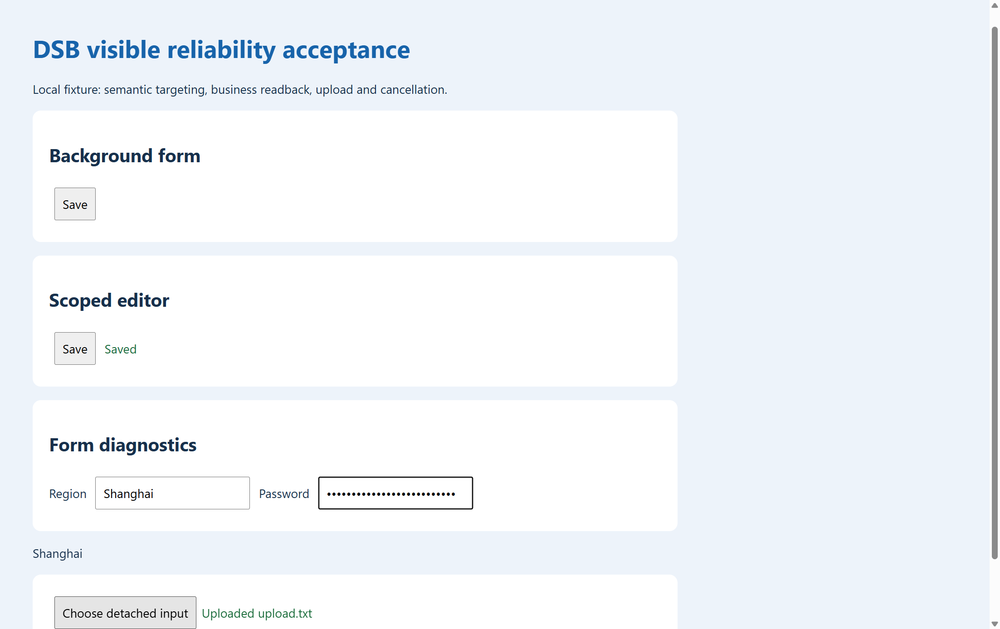

# 命令可靠性与可见浏览器验收

验收日期：2026-10-15，Asia/Shanghai。后端和 CLI 配合提供命令阶段诊断、按命令取消、稳定定位、业务断言、上传观察和凭据留档保护。调用方法见 [命令可靠性分册](../.agents/skills/deepseek-browser-use/references/command-reliability.md)。

## 验收环境

使用独立端口 10059 和对应的独立 profile，Chrome 显示窗口。测试仅访问本地临时 HTTP 页面，包含两个同名保存按钮、延迟保存状态、关联到表单外弹层的 combobox，以及点击后创建的未挂载 file input。默认端口上的已有任务未参与测试。

测试脚本为 [reliability_browser.py](../tests/reliability_browser.py)，所有浏览器操作均通过 dsb CLI 执行。可在仓库根目录复现：

```powershell
# 先确认测试端口未被其他任务使用
dsb --port 10059 server build
dsb --port 10059 server start
python tests/reliability_browser.py --port 10059 --id 2026101501
```

脚本打印每项 PASS，将本次调用记录与 acceptance.json 写入独立的 `logs/reliability-acceptance/` 子目录。最后解除测试任务控制并保留浏览器页面；本地页面服务器随测试结束退出。

## 实际结果

| 场景 | 核验结果 |
| --- | --- |
| 可见窗口 | start 回执确认 headless=false |
| 同名按钮 | 两个 Save 匹配时拒绝点击，返回两条候选及 actionExecuted=false |
| 限定范围与延迟断言 | 仅点击 dialog 内 Save；状态变为 Saved，回读 saves=1、wrong=0 |
| 快照版本 | 生成新快照后，携带旧版本的索引点击返回 STALE_SNAPSHOT，动作未执行 |
| 毫秒等待 | timeoutMs=200 的不存在文本等待，本次端到端耗时约 0.23 秒 |
| 表单与外部弹层 | domValue、displayValue 均为 Shanghai，selectedOptions 读到弹层选中项 |
| 临时文件选择器 | 捕获未挂载 input 的选择器事件，fileSelected=true；上传响应 HTTP 200、uploadCompleted=true，页面出现 Uploaded |
| 中文 stdin | 带 UTF-8 BOM 的参数输入成功返回“中文” |
| 凭据留档 | 合成密码和 sensitive JS 返回值未出现在本次 CLI 请求、响应与 steps.log；服务端当日 trace 检索也未发现该合成值 |
| 取消与诊断 | 长 Promise 执行期间 diagnose 可返回；指定 commandId 取消被接受，工作线程退出后任务可继续读取标题 |

上述场景共 11 项通过。单元与兼容性检查另覆盖取消前阻止执行、未响应中断的工作线程继续占用任务、异步批次占用、断言失败不重复动作、嵌套敏感留档、旧快照和重复 stdin 来源。

Java 针对性检查 30 项、协议/重试/skill 一致性检查 25 项通过，均无跳过；Go `go test ./...` 通过。后端与 CLI 按各自 build.txt 执行 `build`；用于运行的后端通过 `dsb server build` 打包，构建跳过 GPG。

## 可见页面证据

以下为视口截图：可见两个 Save 按钮、Saved 状态、表单显示值及 Uploaded upload.txt。截图作为可见过程留证，提交次数、取消状态和日志脱敏以回执及记录检查为依据。



## 使用边界

取消表示阻止待执行步骤并请求中断，不能撤销已派发给浏览器的操作。任务释放后仍应先观察业务结果。文件选择成功与 HTTP 响应成功分别记录，应用业务是否成功由断言或业务记录核验。本次使用合成页面和小文本文件，未覆盖所有站点组件、浏览器引擎或大文件上传。
