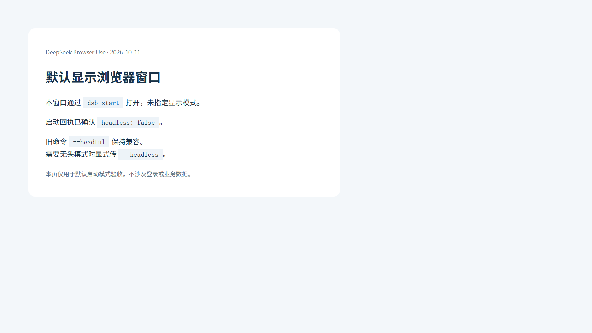

# 默认显示浏览器窗口

`dsb start` 默认启动有界面浏览器，可以直接观察页面操作，并在需要时接手登录或验证。

```powershell
dsb --id 1001 start            # 默认显示窗口
dsb --id 1001 start --headful  # 兼容旧命令，同样显示窗口
dsb --id 1001 start --headless # 显式使用无头模式
```

上面三条是替代用法，不能对同一活跃任务重复启动。`--headful` 与 `--headless` 同时出现时，CLI 返回用法错误（退出码 3），不会发送启动请求。

协议参数 `headless` 默认 `false`；单条和批量 `start` 行为相同。显式传 `true` 才使用无头模式。通过启动回执的 `data.browser.headless` 确认实际模式。共享浏览器还有任务时不能切换模式，请协调任务所有者完成任务后再切换。

## 验证记录

2026-10-11，Asia/Shanghai，Windows、本机 Chrome。使用独立端口与独立 profile，仅访问本地验收页面。

| 检查 | 结果与范围 |
| --- | --- |
| CLI `start` 不传模式参数 | PASS：回执 `headless:false`，页面标题与正文读取成功；Windows 检测到对应 Chrome 窗口及非零窗口句柄 |
| CLI `start --headful` | PASS：回执 `headless:false`，兼容旧命令 |
| 协议单条 `start` 不传 `headless` | PASS：回执 `headless:false` |
| 协议批量 `start` 不传 `headless` | PASS：子命令回执 `headless:false` |
| 显式 `--headless` 与 profile 参数组合 | PASS：Go HTTP 契约测试确认发送 `headless:true`；未启动无头浏览器进行页面测试 |
| 两个开关同时传入 | PASS：Go 参数测试覆盖两种顺序，均拒绝 |
| CLI 构建与安装 | PASS：`dsb` 目录运行 `build`，完成 `go test ./...` 与 `go install .` |
| 后端构建 | PASS：`playwright-server` 目录运行 `build`，完成安装与可执行包构建，跳过 GPG 验证；该构建配置跳过测试 |
| Skill 文档一致性 | PASS：`SkillDocConsistencyTest` 的 9 项测试通过 |
| 既有命令覆盖检查 | `CommandTableTest` 的 10 项中 9 项通过；缺参数覆盖清单尚未登记既有 `clone_profile`、`list_profiles`，本次未调整该清单 |

下面是本次默认启动任务的**页面视口截图**，截图未降级。截图仅展示页面内容；显示模式的依据是启动回执及 Windows 窗口检查，不以页面中的说明文字替代验证。


